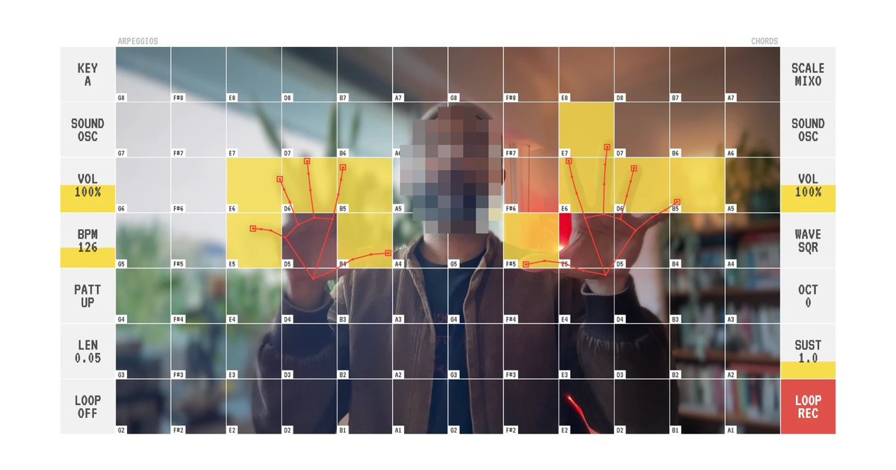

# Hand Synth

Play music with your hands in front of your webcam. The left half of the grid plays arpeggios, the right half plays chords. Close a fist to open that side's sound controls, pinch to set them, loop each side, and record what you play to a WAV file.



**Live:** https://dinefining.github.io/hand-synth/

## Gestures

| Gesture | What it does |
| --- | --- |
| ✋ Open hand | Touch cells with your fingertips to play. Your left hand plays the arpeggio half, your right hand the chord half. |
| ✊ Fist (hold until the disc fills) | Locks that side and opens the sound controls on the other side. They stay open while the fist is closed. |
| 🤏 Pinch | Picks an option or drags a slider in the open controls. |
| 🤘 Horns (hold) | Starts recording after a 5 second countdown. Do it again to stop: the recording downloads as a WAV. |

Everything also works with a mouse or touch: click a side's slots to open its controls, and click REC at the top right to record.

**Sounds:** each side's SAMP row has OSC, PLUCK, BELL, KEYS and MORE. MORE opens a picker of 29 built-in instruments, plus LOAD for your own audio file.

**Loops:** each side has one loop. Pinch LOOP to arm it, open your fist and play (it records from your first note on that side), then close a fist to end the take and it repeats. Pinch LOOP again to clear.

On a phone held upright, the grid turns: arpeggios on top, chords below.

## Run it locally

Requires [Node.js](https://nodejs.org) 20 or newer.

```bash
npm install
npm run dev
```

Then open http://localhost:3001 and allow camera access. Browsers only allow the camera on `localhost` or over HTTPS, so to try it on a phone, use the deployed site.

## Deploy

The app is TypeScript and React, so it has to be built into plain HTML and JavaScript before a browser can run it. Opening the source `index.html` directly, or serving the repo's source files as-is, gives a blank page.

**Automatic (this repo):** pushing to `main` builds the app and publishes it via `.github/workflows/deploy.yml`. One-time setup: in **Settings → Pages**, set **Source** to **GitHub Actions**.

**Manual:** run `npm run build` and upload the contents of `dist/` to any static host, or to a GitHub repo with **Pages → Deploy from a branch → / (root)**. The build uses relative paths, so it works from any folder or repo name.

The link-preview tags in `index.html` point at `https://dinefining.github.io/hand-synth/`; update them if the site lives elsewhere.

## How it's built

- **Hand tracking:** [MediaPipe Hands](https://developers.google.com/mediapipe), steadied with a One Euro filter (`smoothing.ts`)
- **Sound:** the Web Audio API; every instrument is generated in code (`audio.ts`), and recording taps the master output into a WAV
- **UI:** React, drawn on a single canvas (`hooks/useHandMusic.ts`), in the VT323 font
